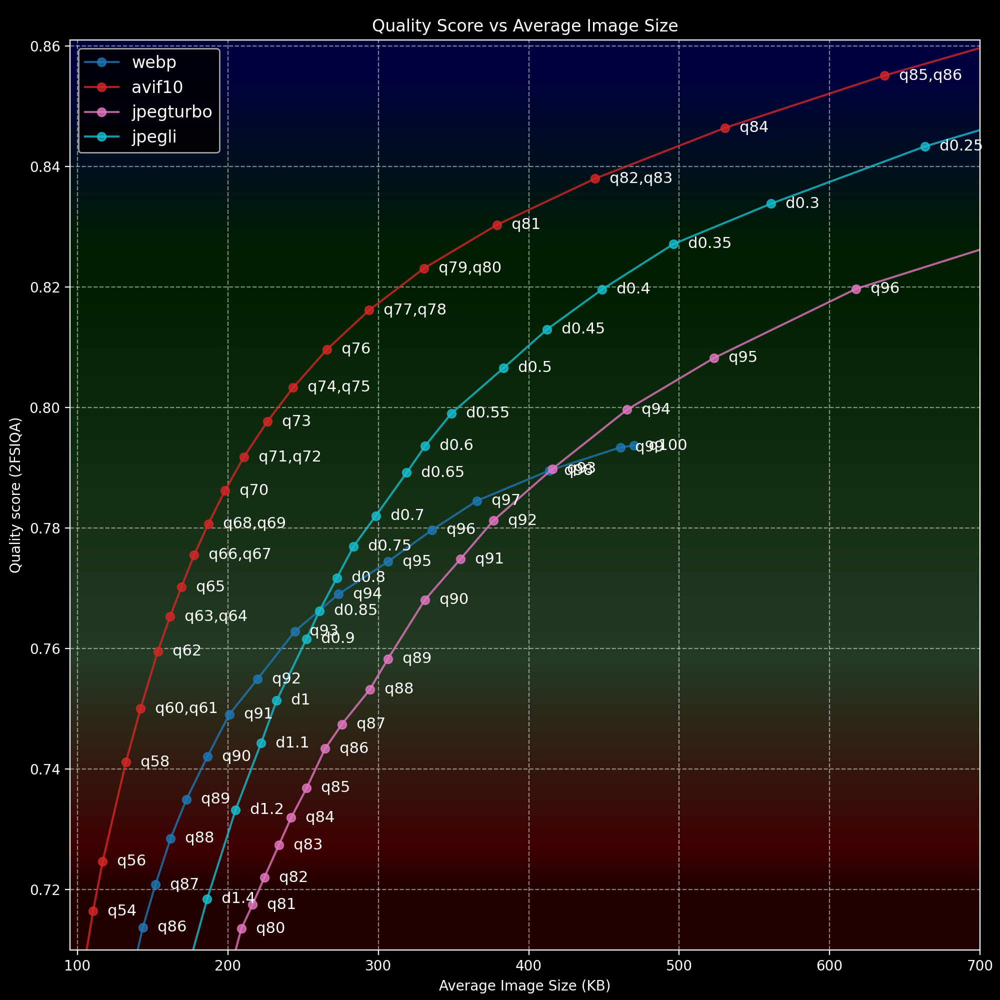
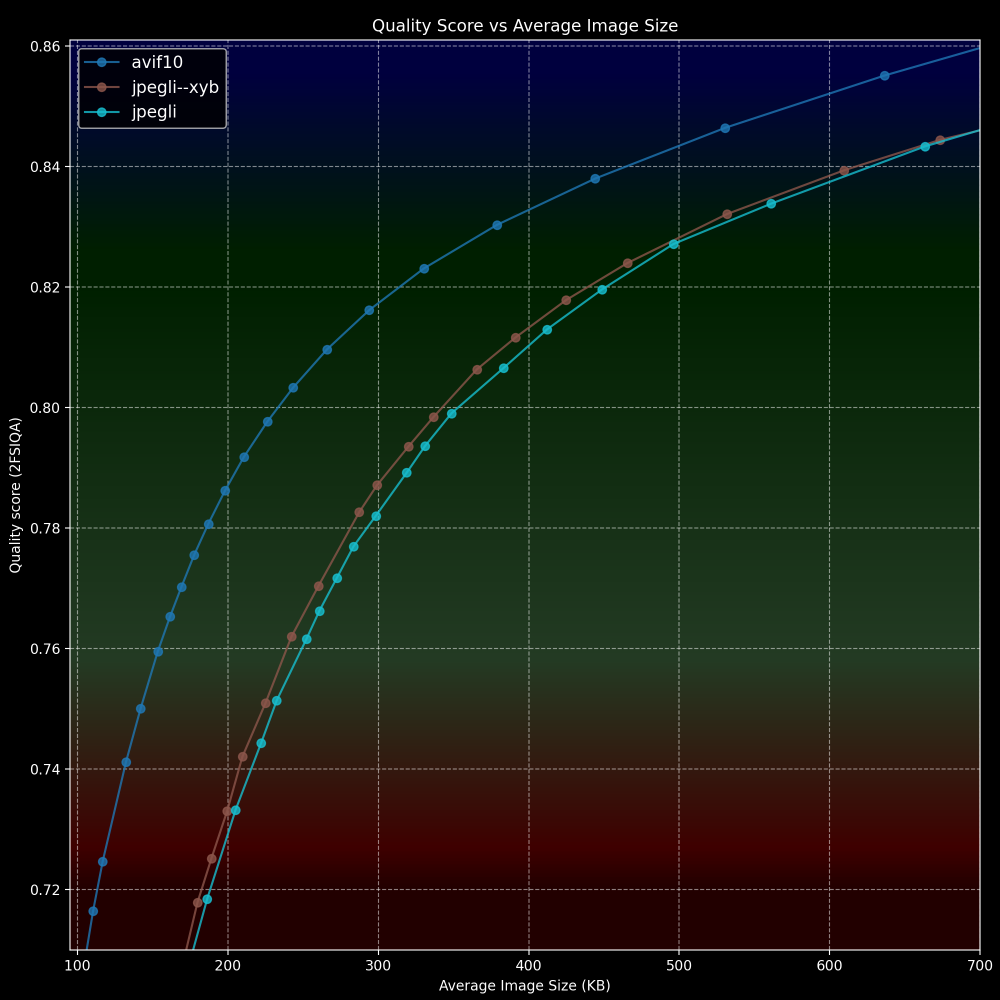
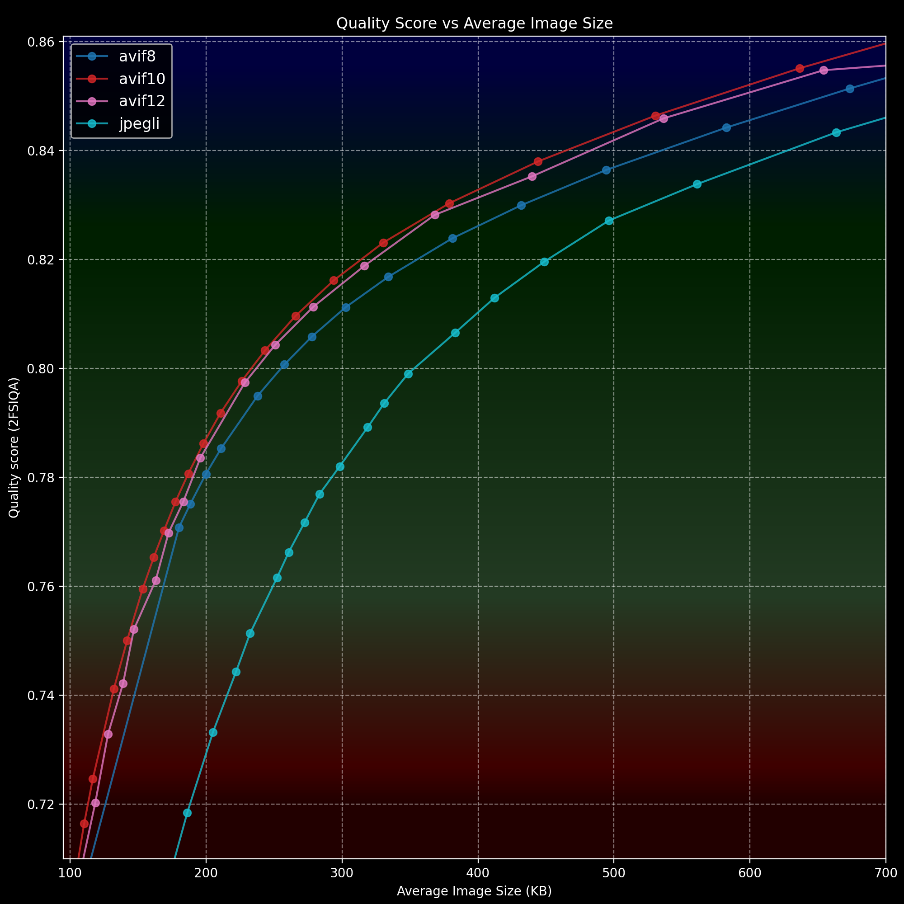
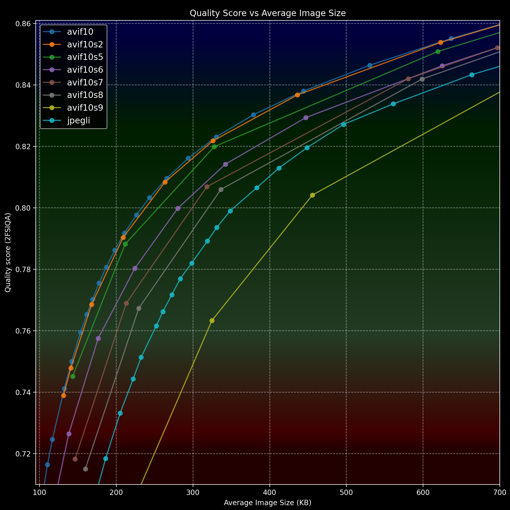
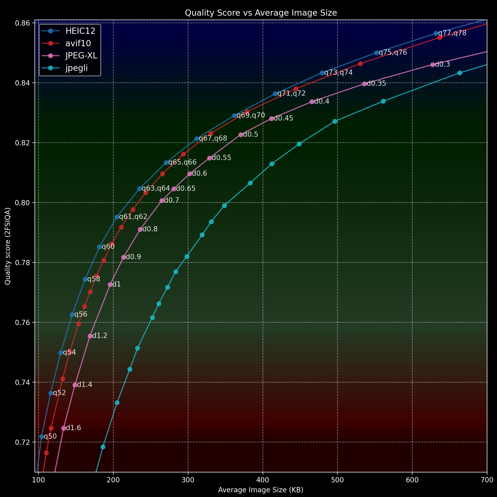

# Lossy Image Encoding Efficiency Synthetic Comparison 01.2026

## Introduction

My personal testing has gone too far and gotten coherent enough to have non-zero value if shared with this lovely community.

The purpose of the testing is to understand the efficiency of various lossy image formats and determine the optimal quality range for each.
All of this is in the context of web readiness and browser compatibility as of the beginning of 2026. So, basically, main focus is JPEG, WebP, and AVIF.

My 228 images testing dataset consists mostly of CG art and some photography. All of the source files are 16-bit, all approximately 1.5 MP (it's close to what Instagram uses, for example).

The 16 bit depth dataset provides headroom for higher-bit encoders, *but it is unlikely* to the extent that it makes this not directly applicable to 8-bit source scenarios.

For highly detailed or noisy sources, the results of this testing could be less relevant in terms of exact optimal quality points, since the size could scale very differently with different encoders. *However, it's unlikely* to change the overall efficiency trends in any way.

Let's bear in mind that my interpretation of all this is subjective, and couldn't be anything else by its nature. There is an invisible prefix "As a random internet person said" for everything below. I won't flood the text with 'In my opinion' or 'By my estimation'. The only objective data are the sizes, and the somewhat objective quality score. Everything else is an opinion.

How good is the quality score? It looks sane, and holds well against my blind tests.

With all this aside...

## Quick recommendations:

If you're looking for a quick answer, the magic ball has spoken: use Jpegli with distance 0.44. Good luck! Thanks for reading.

Oh, wait! Here's the command line: `cjpegli "Input.png" "Output.jpg" -d 0.44` -- This one's good, you'll laugh, you'll cry, it'll change your life!

You'll get a high-quality JPEG with a reasonable file size. You won't have to compromise on compatibility or quality, nor will you waste precious KBs. It's a win-win-win!

If you are interested in some explanations, [here they are](Why_and_how.md)

Okay, that's all for the quick recommendations. Let's move on! Next, we have some longer answers.

## Methodology

- For each format, every image in the dataset was converted with the same settings and different quality levels.

- To compare the output and source files of each encoder, the respective decoder included in their library was used to convert output files back to PNG.

- Each file was compared to the original using the following metrics: SSIMULACRA2, kornelski's dssim, VMAF, ffmpeg's SSIM, Butteraugli and PSNR. The results of the comparison between all files in the quality run were averaged to an arithmetic mean.

- Finally, all of these metrics were used to calculate a composite score. To separate it as its own metric it's called 2FSIQA. [Here are the details.](2FSIQA.md)

## Main test and interpretation:

[Results table](/results_table.md) - here's results of main testing in form of table, but it's simpler to have a look at them in graph form:

Red area (below 0.74) – low quality | Light green-green area – normal to high quality | Blue area (above 0.84) – a slow burn from visually lossless to mathematically lossless.

So we are getting "useful" ranges for every codec and can focus on them:

- AVIF - quality 54-86

- Jpegli - distance 1.4–0.25

- libjpeg-turbo - quality 80-96

- WebP - quality 86-100

While a higher quality number means higher quality, with distance, it works the opposite way: lower distance means higher quality.

## Quality map

Since we're talking about high quality web pictures it's easy to assume our sweetspots are somewhere in dark green (0.79-0.83 quality score) area of the graph. If we were targeting the most compact size without much loss, it's okay to look at lower part of light green area (0.76-0.78 quality score).

Let's estimate some numbers:

| Quality Level                        | AVIF -q | Jpegli -d | WebP -q |
|--------------------------------------|---------|-----------|---------|
| Very high quality                    | 82      | 0.3       | -       |
| High quality (theoretical sweetspot) | 77      | 0.45      | -       |
| Normal quality                       | 70      | 0.65      | 98      |
| Low quality                          | 62      | 1.0       | 92      |
| Very low quality                     | 54      | 1.4       | 86      |

## Overview

WebP:

Starting with the most deviant format on the graph, WebP is efficient at low quality levels but deteriorates significantly when trying to achieve a high level of quality. This is not surprising, as its design restricts the format to YUV 4:2:0, resulting in the loss of half of the color information. WebP could serve you well at quality levels between 86 and 93 (very low to low quality), as it is fast and effective. However, for higher quality levels, WebP is essentially not worthwhile. WebP has excellent lossless capabilities, but that is outside the scope of this test. Nonetheless, it beats JPEG by supporting transparency.

Jpegli vs libjpeg-turbo:

Both encode usual, compatible with everything, JPEGs, but with Jpegli being obviously superior. While it presents some unusual artifacts, like slight color shifts on small details, it makes classic JPEG artifacts less visible, smoothing things out. While classic JPEG encodes (e.g. libjpeg-turbo) could win in direct comparison in details sharpness, and color accuracy, this win is mostly negligible if we compare overall image distortion difference. This leads to a straightforward recommendation to switch to Jpegli as the new default JPEG variant.

AVIF:

Well, it's as good as the graph shows. It retains all the details extremely well at higher quality and it's very efficient at lower quality. There is a stereotype that at lower AV1 and AVIF qualities, its compression artifacts are more aesthetically pleasing than JPEG's, but this is a debatable point since it (indeed very intelligently) gets rid of "less important" details as it compresses the image, starting with dithering, moving on to subtle textures and so on. So, would you prefer to have the details present in your picture at the cost of a distorted appearance, or a clean but less detailed representation? It's a case of choosing your poison, where there is no right answer. I would say that synthetic scores separate it fairly.

## The CLI commands used

- AVIF: `avifenc -q <QUALITY> -s 0 --depth 10 --cicp 2/2/0 -c aom "input.png" -o "output.avif"`
- WebP: `cwebp -q <QUALITY> -m 6 -pass 10 -sharp_yuv -af -mt -metadata icc "input.png" -o "output.webp"`
- Jpegli: `cjpegli "input.png" "output.jpg" -d <DISTANCE>`
- libjpeg-turbo: `magick "input.png" ppm:- | cjpeg -optimize -quality <QUALITY> -sample 1x1 -outfile "output.jpg"`

Versions:
- avifenc ([libavif](https://github.com/AOMediaCodec/libavif)): Version: 1.3.0 (dav1d [dec]:1.5.1-0-g42b2b24, aom [enc]:3.12.1)
- cwebp ([libwebp](https://github.com/webmproject/libwebp)): version 1.6.0 | libsharpyuv: 0.4.2
- cjpegli ([libjxl](https://github.com/libjxl/libjxl)): build from November ‎24, ‎2025
- cjpeg ([libjpeg-turbo](https://github.com/libjpeg-turbo/libjpeg-turbo)): version 3.1.2 (build 20250903)
(Used build of libjpeg-turbo doesn't support PNG input files, so it was paired with ImageMagick.)

## Jpegli XYB mode

You could make Jpegli slightly more efficient by changing its color space representation to that of JXL. Example command line: `cjpegli "input.png" "output.jpg" --xyb --chroma_subsampling=444 -d <DISTANCE>`

However, this comes at the cost of losing JPEG's broad compatibility, since it's far from standard behavior, and the overall win doesn't seem worth it.

## More on AVIF

In context of AVIF there is two questions that should be discussed. Why 10-bit was chosen, and what about its speed?

The answer to the bit depth question is simple. In my testing, 10-bit AVIF was the most efficient. It looks like the 12-bit mode doesn't work as it should, or maybe decoding is faulty, or this is how AVIF should be, who knows. Here's a graph:

It's worth mentioning that, for extremely low qualities (below 50), 8-bit will give you better efficiency, but that's outside the scope of this test.

Regarding speed, the advanced "speed of encoding" benchmarking isn't part of this article for many reasons. The first main reason is that it's not "huge production" oriented testing. If you want a couple of your web-ready images in best quality, you could just hit the slowest preset and wait minute or two, no big deal, and if it's big batch you're dealing with that you need to convert ONLY ONCE, it's still tolerable. Second main reason is that it would be big tests of its own, which would require more controllable environment, other AVIF encoders, and so on. But we still can look at some relative numbers, just to have some basic grasp.

`avifenc` from libavif has effort contolled by switch -s/--speed, here's quote from help text: `Encoder speed in 0..10 where 0 is the slowest, 10 is the fastest. Or 'default' or 'd' for codec internal defaults. (Default: 6)`

We will be using a relative number for speed, using Jpegli encoding speed as a baseline, so I am simply dividing the time taken in AVIF by the time taken in Jpegli.

| AVIF speed | Time taken |
|------------|------------|
| 0          | x148.2     |
| 1          | x84.4      |
| 2          | x65.5      |
| 3          | x41.4      |
| 4          | x24        |
| 5          | x14.8      |
| 6          | x3.5       |
| 7          | x3         |
| 8          | x2.2       |
| 9 and 10   | x1.3       |

Speeds 9 and 10 returned identical results at identical time.

Obviously, "Speed 0" looks VERY slow, but in context, it takes Jpegli about a 0.3 seconds to encode a 1.5 MP image, whereas AVIF takes 45 seconds for the same task, not a tragedy.

Of course, providing general advice that results in wasted time and electricity is not ideal. To find a compromise, let's examine the encoding efficiency of different AVIF speeds on a graph.

As you can see from this graph, choosing speed 2 won't result in any meaningful loss of efficiency and will give you a more than 2x increase in encoding speed. I wouldn't go below avifenc's default of 6 for the fastest speed since it gives us the best time/efficiency balance.

## HEIC and JPEG-XL

While we're at it, we might as well take a brief look at two other modern formats:

Command lines:

- HEIC `heif-enc.exe -q <QUALITY> --bit-depth 12 -e x265 -p preset=placebo -p complexity=100 -p chroma=444 "input.png" -o "output.heic"`
- JPEG-XL `cjxl "input.png" "output.jxl" -d <DISTANCE> -e 9 --brotli_effort=11`

Versions:
- heif-enc ([libheif](https://github.com/strukturag/libheif)): Version: 1.20.2
- JPEG-XL ([libjxl](https://github.com/libjxl/libjxl)): Version: v0.12.0

HEIC edges out AVIF, but the quality settings are pretty extreme, and it's certainly not fast.

Interestingly, JPEG-XL produces an almost identical result to the 8-bit AVIF. I used -e 9 because going above that is impractical unless you're immortal or something.

## FIN

By the end of this, I hope we have all converted to something new and learned to appreciate our own unique qualities.

Anyhow, have a nice day and happy image creation!
