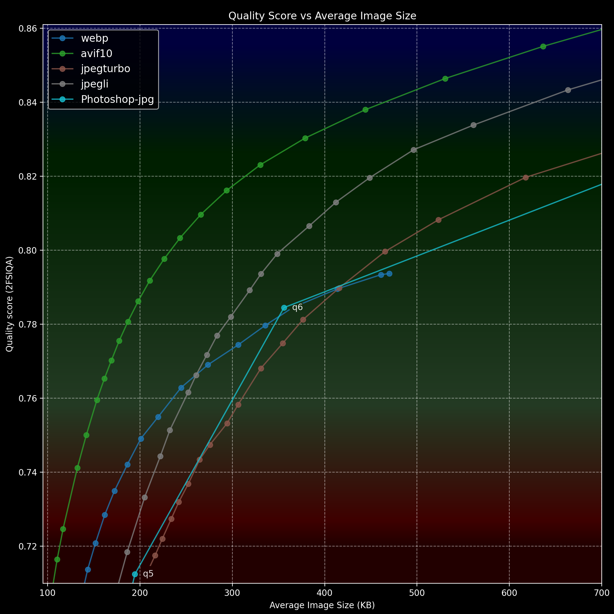

# Why and How

## Why use command-line image encoding at all?

Using CLI encoders for image compression seems counterintuitive. If our goal is to control the quality, shouldn't we examine the image ourselves at each quality level?

The first part of the answer is obvious: doing it manually is time-consuming.

The second part is... control. You know exactly which encoder is being used, the quality it works on, and the result is predictable. To illustrate this, we could look at the industry standard (in the old days at least) Adobe Photoshop 2026.

Its current "Export as..." function is an extreme example of a lack of control:

Its baffling seven levels of quality with only two of them that got on our graph of relatively sane values - quality 6 in "normal quality" range and quality 5 on very bottom of graph could be considered "very low" quality. It's not that bad, but... well... It's an extreme example, and for now you can still use the "Legacy" version of the export feature in Photoshop, which uses a 1–100 gradation, also you can add a plug-in for export. Or, alternatively, you can save as a PNG and use a command line encoder.

I can only shrug and tell you that it's convenient once you're used to it, also it's great for batch processing, although it does require some basic scripting.

## How to use CLI encoders (Windows):

If you are new to the concept of command-line tools, here's a quick and very simple entry point for Windows users:

[Here](scripts/Convert_example) you can find batch file (Convert-to-jpeg.bat) and Jpegli encoder binary (cjpegli.exe). To use this duo, place them in same folder together with your PNG, drag and drop your PNG file into batch, and as a result you'll get encoded JPEG file. Be careful, if your_file.jpg already exists in folder it will overwrite it.

You can make this more flexible by placing cjpegli.exe file into your PATH. That way, you could, for example, put Convert-to-jpeg.bat on your desktop and drag and drop your source image into it from any folder.

If in doubt how to do that PATH thing: create folder in root of your hard drive, for example "CLI_Encoders", so full path will be C:\CLI_Encoders, and drop cjpegli.exe inside, after that you'll need Google how to add a folder into PATH on Windows.

Once C:\CLI_Encoders will be inside the path, cjpegli.exe and any other encoder you place inside this folder will work as command line functions. Process will take a couple of minutes and it's very much worth it.

Moving on: if you'd open Convert-to-jpeg.bat with notepad you'll see `cjpegli "%~1" "%~dpn1.jpg" -d 0.44` command in it. It's first command from qick recommendation `cjpegli "Input.png" "Output.jpg" -d 0.44`. Names of input and output files are different because this is one way to make bat file work as drag and drop processor.

If you get avifenc.exe from [libavif release package](https://github.com/AOMediaCodec/libavif/releases) and change content of the batch file to  `avifenc -q 77 -s 0 --depth 10 --cicp 2/2/0 -c aom "%~1" -o "%~dpn1.avif"` you'll get drag and drop AVIF converter.

If you placed encoders .exe files in PATH, you can try to use this magic from PowerShell: Shift + right click inside folder with your image => "Open PowerShell window here" => copy paste `cjpegli "Input.png" "Output.jpg" -d 0.44` inside PowerShell window. Change your file name to Input.png or change name inside command for this to work.

Now that you have this knowledge, you can officially consider yourself a hacker! Congratulations!
